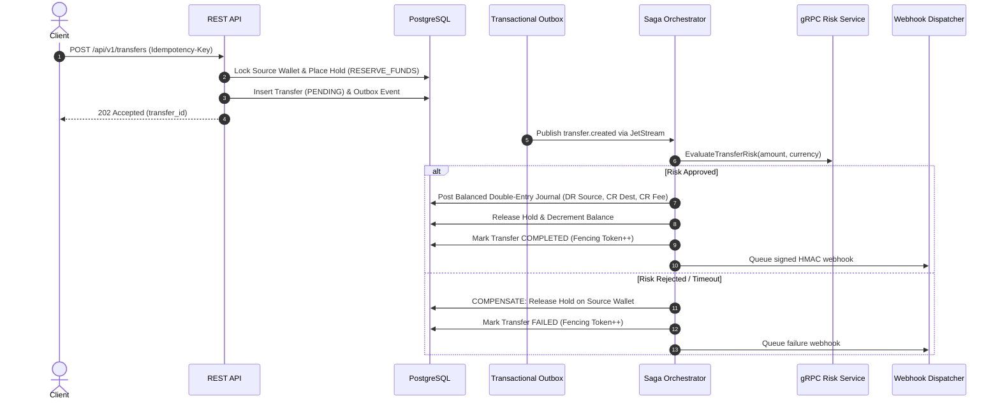

# Comprehensive Engineering Design Document
## Distributed Wallet & Payment Ledger Platform with Saga-Based Transfers

### 1. Executive Summary
This document outlines the architecture, financial guarantees, concurrency control, messaging semantics, and failure recovery protocols of the **Distributed Wallet & Payment Ledger Platform**. The central invariant is: **money must never be created, lost, or double-spent, under any failure, crash, network partition, or concurrent load condition**.

---

### 2. Double-Entry Ledger Model
The platform adheres strictly to formal double-entry bookkeeping principles.

#### Invariants:
1. **Mathematical Balance**: For every financial transaction represented as a `journal_entry`, the sum of all associated `ledger_entries` debits (`DR`) must equal credits (`CR`):
   $$\sum \text{Amount}_{\text{DR}} = \sum \text{Amount}_{\text{CR}}$$
2. **Integer Minor Units**: All monetary values are represented as 64-bit signed integers (`int64`), designating minor units (e.g. cents in USD/EUR). Floating-point representations are forbidden to eliminate binary precision drift.
3. **Strict Append-Only Storage**: Journal entries and ledger entries cannot be modified or deleted. An active PostgreSQL row-level trigger (`trg_prevent_ledger_update_delete`) intercepts and raises exceptions on any `UPDATE` or `DELETE` statement at the database engine level.
4. **Correction via Compensating Entries**: Corrections are posted exclusively as new balanced reversal entries with inverse directional entries referencing the original transfer or deposit.
5. **System Accounts**:
   - `external_funding`: Offsets external incoming funds during deposits.
   - `fees`: Collects platform service fees posted as distinct balanced legs.
   - `suspense`: Isolates in-doubt funds during dispute resolutions.

---

### 3. Isolation Levels & Concurrency Control
Financial operations use **PostgreSQL with `READ COMMITTED` or `SERIALIZABLE` guarded transactions** coupled with pessimistic row-level locking (`SELECT ... FOR UPDATE`):

| Operation | Isolation / Mechanism | Justification |
|---|---|---|
| **Transfer Acceptance & Fund Reservation** | `READ COMMITTED` with `SELECT ... FOR UPDATE` | Prevents race conditions during available balance checks. Row-level locks isolate the source wallet balance. |
| **Deadlock Avoidance** | Deterministic UUID Sorting Lock Ordering | When moving funds between two wallets (A and B), the locks are always acquired in lexicographical order: `MIN(id_A, id_B)` followed by `MAX(id_A, id_B)`. Bidirectional concurrent transfers ($A \to B$ and $B \to A$) execute without circular deadlocks. |
| **Saga Step Transitions** | Optimistic Fencing Tokens (`fencing_token = fencing_token + 1`) | Prevents stale orchestrator workers or partitioned instances from overwriting newer state updates. |

---

### 4. Saga Orchestration State Machine
A transfer executes across 5 asynchronous phases:

---

### 5. Idempotency & Transactional Outbox/Inbox
- **API Idempotency**:
  - Requires `Idempotency-Key` header on `/wallets/:id/deposit`, `/transfers`, and `/transfers/:id/reverse`.
  - The request payload is hashed (`SHA-256`).
  - Concurrent identical requests wait or receive cached responses.
  - Reusing an existing key with a mismatched request payload immediately yields `422 Unprocessable Entity`.
- **Transactional Outbox**:
  - Guarantees that database commits and message publication never diverge. Events are saved in the `outbox_events` table within the same ACID database transaction as the financial state changes.
  - A dedicated relay publishes outbox events to NATS JetStream with durable message IDs.
- **Inbox Deduplication**:
  - Downstream message consumers insert incoming message IDs into `inbox_records` with a unique constraint. If a redelivery occurs, the unique violation prevents double processing, converting at-least-once transport delivery into effective end-to-end exactly-once semantics.

---

### 6. Distributed Caching & Rate Limiting Degradation Matrix
The system utilizes Redis for fast sliding-window rate limiting and distributed locking:

| Component | Redis Failure Mode | Architectural Justification |
|---|---|---|
| **Rate Limiter** | Fail Open | Payments must not fail due to a temporary caching/telemetry outage. PostgreSQL row locking and ledger constraints protect financial integrity even under high load. |
| **Distributed Locks** | PostgreSQL Fallback | Distributed locks in Redis serve as fast short-lived deduplication optimizations. PostgreSQL `SELECT ... FOR UPDATE` row locks are the authoritative ground truth. |
| **Read Cache** | Cache-Bypass | Balance queries fall back directly to reading PostgreSQL wallet rows. |
